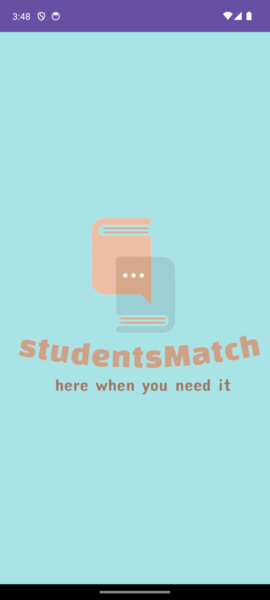
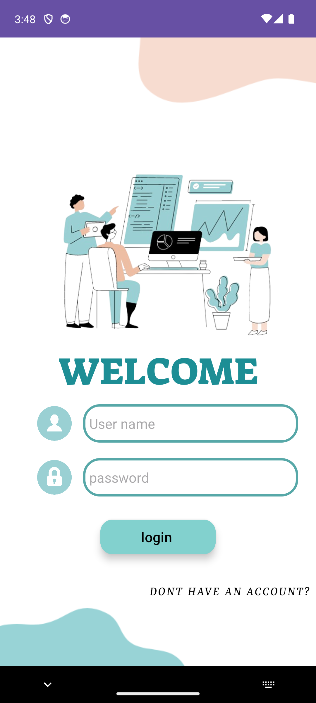
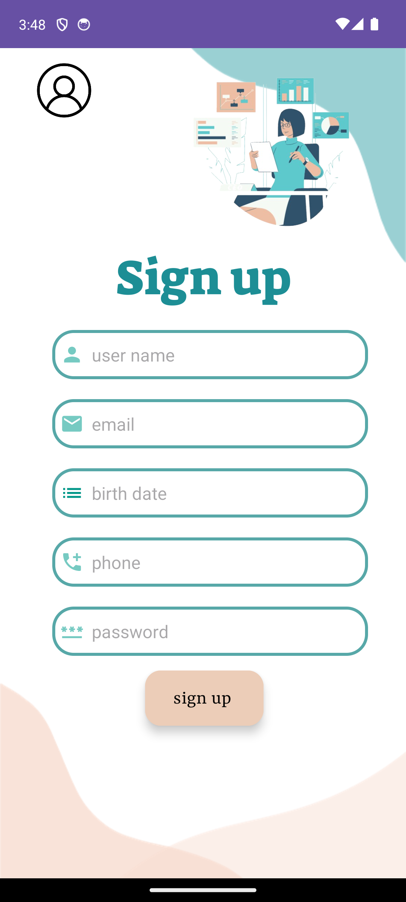
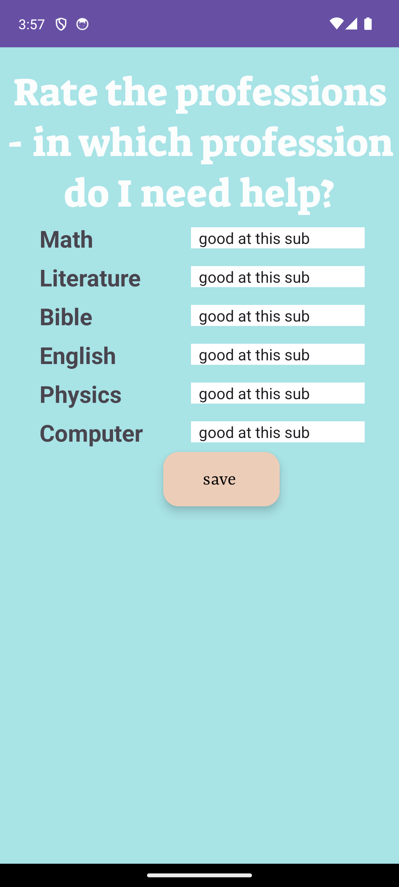
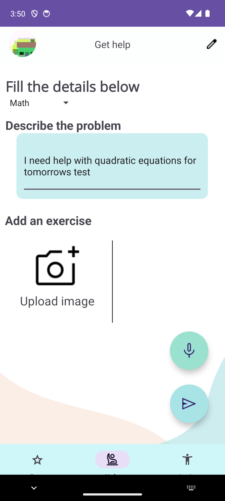
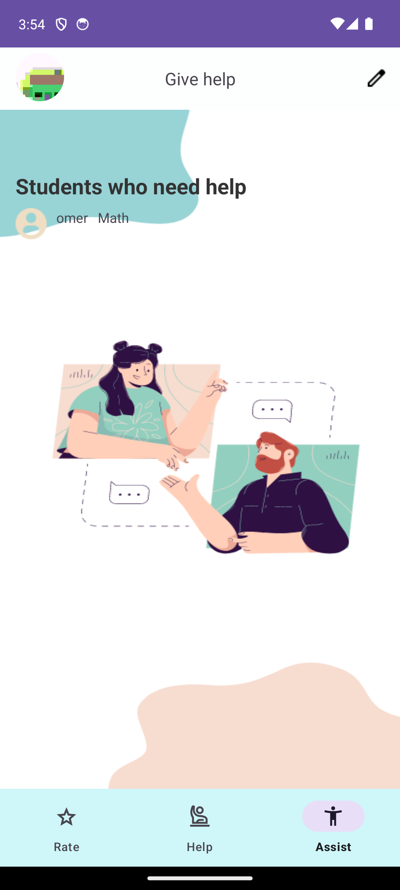
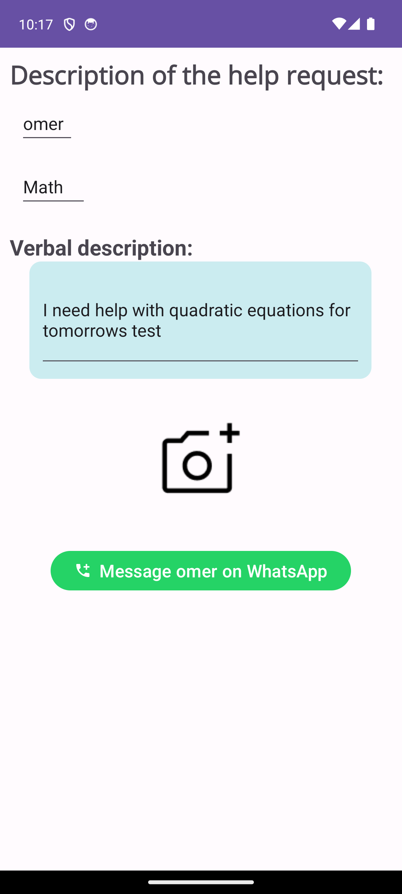
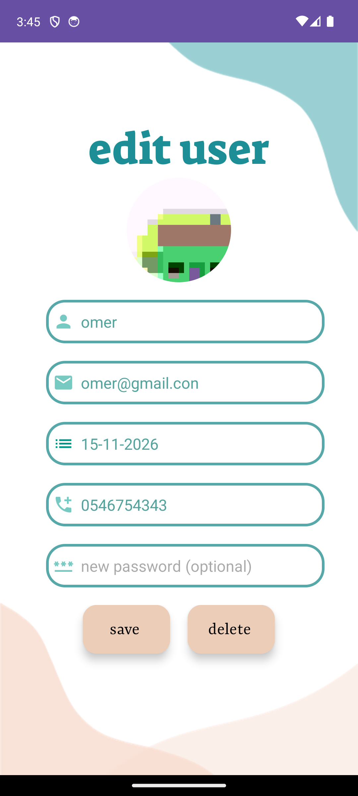

# StudentsMatch

**here when you need it** — an Android app that connects students who need help in a subject with students who are good at it.

A student rates which subjects they're strong in and which they need help with. They can post a help request (subject, description and an optional photo of the exercise), and every student who is good at that subject sees the request in their **Give help** list.

<p>
  
  
  
  
</p>
<p>
  
  
  
  
</p>

## Features

- **Sign up and log in** with input validation (email format, 10-digit phone number, minimum password length, date picker for the birth date). The app remembers the last user name.
- **Profile photo** taken with the camera (`ActivityResultContracts.TakePicture` + `FileProvider`), shown on the home and edit screens.
- **Rate your subjects**: for each subject the student marks "good at" or "need help".
- **Get help**: post a request with a subject, a description and an optional exercise photo picked from the gallery (Android Photo Picker).
- **Give help**: a list (`RecyclerView`) of requests in the subjects *you* are good at. Tap one to see its details.
- **Message on WhatsApp**: from a request, the helper can open a WhatsApp chat with the student, using the phone number from the student's profile and a ready-made first message.
- **Edit or delete your profile**, including a new photo and an optional new password.
- Bottom navigation with fragments, Material 3 components, custom fonts and illustrations.

## Tech

| | |
|---|---|
| Language | Java |
| UI | XML layouts, Material Components, `RecyclerView`, Fragments, `BottomNavigationView` |
| Storage | SQLite (`SQLiteOpenHelper`), `SharedPreferences` |
| Device features | Camera, Photo Picker, `FileProvider` |
| Security | Passwords hashed with PBKDF2-HMAC-SHA256 and a random salt |
| Build | Gradle (Kotlin DSL), Android Gradle Plugin 9.5, min SDK 30 (Android 11) |

## Project structure

```
app/src/main/java/com/example/studentsmatch/
├── StartActivity.java            splash screen
├── LoginActivity.java            log in
├── RegisterActivity.java         sign up + profile photo
├── RateActivity.java             rate your subjects
├── MainActivity.java             home: bottom navigation + top bar
├── GethelpFragment.java          post a help request
├── GivehelpFragment.java         requests you can help with
├── RequestAdapter / RequestHolder  RecyclerView list
├── HelpDescriptionActivity.java  request details
├── EditUserActivity.java         edit / delete profile
├── HelperDB.java                 SQLite schema
├── User.java, Request.java       data models
├── ProfilePic.java               loads photos (downscaled, correct orientation)
└── PasswordHasher.java           PBKDF2 password hashing
```

## Running it

1. Open the project folder in **Android Studio**.
2. Let Gradle sync.
3. Pick an emulator or a phone with Android 11 or newer and press **Run ▶**.

On the emulator, the camera shows a virtual scene, so profile photos look like a pixel-art room.

## History

I built StudentsMatch in **2023–2024**, as a student and without AI tools.

In **2026** I brought it up to date:

- Upgraded Gradle and the Android Gradle Plugin so it builds with current Android Studio.
- Fixed the profile photo: changing it from the edit screen wasn't saved, and large camera photos could crash the app or appear rotated.
- Passwords are now stored as salted PBKDF2 hashes instead of plain text, and no longer saved on the device for "remember me". Existing accounts are upgraded automatically the next time they log in.
- Fixed a crash when sending a help request without a photo, and a bug where changing your user name lost your edits.
- Finished the WhatsApp button I started in the original version: it now opens a chat with the student who asked for help.
- Cleaned up: one log tag, removed dead code and leftover placeholder labels, fixed typos in error messages, renamed classes to Android naming conventions.

## Ideas for the future

- Connect the microphone button on the **Get help** screen to speech-to-text (the button is there but not wired up yet).
- Move the data to a server (for example Firebase) so students on different phones can see each other's requests. Today everything is stored locally on one device.
